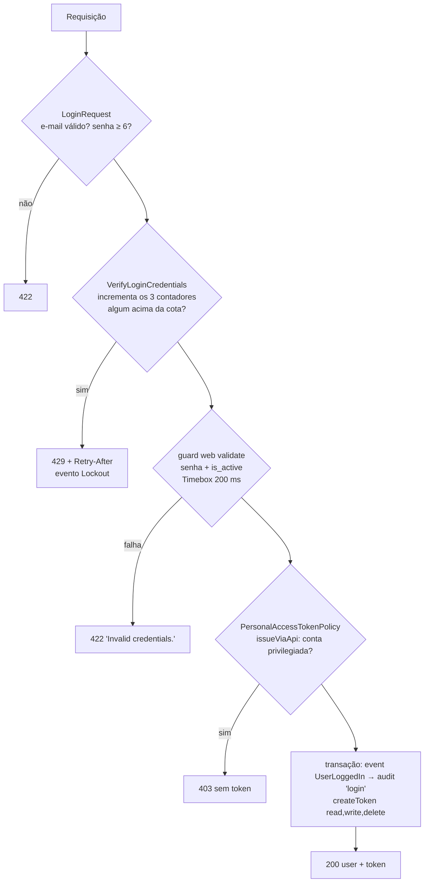

# Autenticação

[← Segurança](README.md) · [ADR-0003](../architecture/decisions/ADR-0003-sanctum.md) · [ADR-0008](../architecture/decisions/ADR-0008-layered-authorization-model.md) · [API v1](../api/v1.md#autenticação)

## Mecanismo

Laravel Sanctum com **personal access tokens** enviados como
`Authorization: Bearer napi_...`. O token em texto claro é devolvido **uma
única vez**, na criação. No banco fica apenas o hash SHA-256
(`personal_access_tokens.token`, único).

A autenticação SPA por cookie **não está ativa**: `bootstrap/app.php` não
chama `statefulApi()`, e o grupo `api` contém apenas `SubstituteBindings`.
`SANCTUM_STATEFUL_DOMAINS` e `guard => ['web']` estão configurados, mas não
são exercidos pelas rotas da API ([ADR-0009](../architecture/decisions/ADR-0009-web-session-and-bearer-adapters.md)). A sessão `web` é usada apenas pela
[área administrativa](#área-administrativa-sessão-web).

## Login: `POST /api/v1/auth/login`

| Controle | Implementação | Teste |
|---|---|---|
| Hash de senha | cast `password => hashed` em `User`; bcrypt (`BCRYPT_ROUNDS=12` no `.env.example`); rehash no login quando o custo muda | indireto (login) |
| Resposta uniforme para e-mail inexistente, conta inativa e senha errada | `VerifyLoginCredentials` devolve `null` nos três casos; o `Timebox` do guard iguala o tempo ([FIND-018](../findings/README.md#find-018--sinais-de-enumeração-no-login)) | `gives the same answer and the same wait…` |
| Rate limit | [proteção de credenciais](#proteção-de-credenciais), compartilhada com o admin | `LoginThrottleTest` |
| Bloqueio de conta inativa | `is_active` nas credenciais do `validate()` | `does not issue a token to an inactive user` |
| Conta privilegiada sem token por senha | `PersonalAccessTokenPolicy::issueViaApi` depois da senha conferida: 403 sem token nem `UserLoggedIn` ([conta privilegiada](#conta-privilegiada)) | `refuses a token to a privileged account on the API login (403)` |
| Auditoria de login | `UserLoggedIn` → `RecordAuditLog`, **uma** linha | `records a login exactly once` |
| Tentativas falhas auditadas | **não existe** (adiado, veja [audit.md](audit.md#cobertura)); o bloqueio dispara o evento `Lockout` | — |

## Proteção de credenciais

Desde o P2.5-T02 ([ADR-0013](../architecture/decisions/ADR-0013-abuse-limits-and-expensive-operations.md)),
toda rota que confere senha chama a Action
`App\Domain\IAM\Actions\VerifyLoginCredentials`: o login da API, o
`/admin/login` e, desde o P2.5-T06, a confirmação de senha do admin. Só a
proteção é compartilhada: o admin abre a sessão `web` e a API emite o token
Sanctum.

| Contador | Chave | Cota | Zera no sucesso |
|---|---|---|---|
| identidade + IP | sha256 do e-mail em minúsculas + IP | 5 a cada 30 min | sim |
| identidade | sha256 do e-mail em minúsculas | 20 por hora | não |
| IP | IP | 100 por hora | não |

- As chaves são as mesmas nas duas rotas: alternar entre admin e API não
  soma cota ([FIND-033](../findings/README.md#find-033--login-do-admin-e-login-da-api-com-orçamentos-independentes)).
- O e-mail é comparado em minúsculas, como o `citext` ([FIND-027](../findings/README.md#find-027--limiter-do-login-da-api-diferencia-maiúsculas-no-e-mail)),
  e guardado como hash, então o cache não tem e-mails em texto claro.
- `RateLimiter::increment()` roda **antes** do bcrypt, e a decisão usa o
  valor que ele devolve. O incremento é atômico no cache `database`:
  requisições simultâneas recebem contadores diferentes ([FIND-028](../findings/README.md#find-028--rate-limiting-não-é-atômico-entre-requisições-simultâneas)).
  Verificado com 20 requisições paralelas contra o PostgreSQL: 5 chegaram à
  senha (422) e 15 receberam 429.
- Tentativa recusada também conta. O 429 traz `Retry-After`, o maior tempo
  restante entre os contadores estourados ([FIND-029](../findings/README.md#find-029--429-do-login-sai-sem-retry-after)).
- Custo aceito: quem conhece um e-mail e usa duas ou mais origens mantém a
  conta bloqueada com ~20 requisições por hora. Sessões e tokens já emitidos
  continuam valendo.
- O IP vem do `TrustProxies` do Laravel. Atrás de um balanceador,
  `TRUSTED_PROXIES` (`config/trustedproxy.php`) é obrigatória; sem ela,
  `X-Forwarded-For` é ignorado ([FIND-030](../findings/README.md#find-030--limites-por-ip-dependem-de-proxies-confiáveis-não-configurados)).

As rotas autenticadas (grupo `auth:sanctum` da API e grupo `auth` do admin)
têm o limiter `authenticated`: 120 requisições por minuto **por usuário**,
somando todos os tokens e a sessão. Ali, o `throttle` padrão do Laravel lê e
depois incrementa; a ultrapassagem se limita às requisições simultâneas do
próprio usuário, e isso é aceito (ADR-0013, item 20).

## Conta privilegiada

Desde o P2.5-T06 ([ADR-0013](../architecture/decisions/ADR-0013-abuse-limits-and-expensive-operations.md), itens 10 a 18),
a senha de uma conta privilegiada só entra pelo `/admin/login`, e o token
dela nasce na sessão do admin, com a senha reconfirmada ([FIND-035](../findings/README.md#find-035--conta-privilegiada-troca-a-senha-por-token-na-api)).

- **Privilegiada** é a conta que entra na área administrativa:
  `AdminNavigation::allows()`, a mesma regra do `admin.access`. Basta uma
  seção visível (por exemplo, só `menus.view`). Owner ou member de
  Organization, sem permissão global, não é privilegiado. Não há flag nem
  lista ([ADR-0008](../architecture/decisions/ADR-0008-layered-authorization-model.md)).
- **Na API**, `PersonalAccessTokenPolicy::issueViaApi` recusa a conta
  privilegiada com 403 e a mensagem
  `Privileged accounts get their tokens in the admin area.` em dois
  pontos: no login, depois da senha conferida pelos contadores, e no
  `POST /tokens`, pelo `TokenStoreRequest`. Saber que a senha está certa
  não dá nada novo, porque o `/admin/login` a aceita com os mesmos
  contadores. Usar e revogar o token emitido no admin continua permitido.
- **No admin**, `/admin/tokens` lista (paginado), cria e revoga os tokens do
  próprio usuário. O link fica no cabeçalho, não na barra lateral: as
  seções da barra definem quem é privilegiado, e um link visível a todos
  tornaria todo mundo privilegiado.
  - Criar exige a senha confirmada nos últimos **5 minutos**
    (`RequirePassword::using('admin.password.confirm', 300)`), e não nas 3
    horas do `auth.password_timeout`. A confirmação confere a senha pela
    `VerifyLoginCredentials`, então erros nela gastam a mesma cota dos
    logins.
  - Validade de **1, 8 ou 24 horas** (padrão 8), abilities do catálogo
    (`read`, `write`, `delete`).
  - O token aparece **uma única vez**, na própria resposta do POST (201,
    `Cache-Control: no-store`). Um redirect com flash gravaria o texto
    puro na tabela `sessions`.
  - Emissão e revogação são as mesmas Actions da API (`IssueAccessToken`,
    `RevokeAccessToken`), com `token_created` e `token_revoked`.
- **Tokens anteriores ao T06**: os tokens de login já emitidos para contas
  privilegiadas não foram revogados por código e expiram no prazo global,
  em até 7 dias. O dono pode revogá-los na própria tela.
- **Risco residual**: uma conta comum promovida a privilegiada mantém os
  tokens de API que já tinha, até expirarem (≤ 7 dias). Não é um desvio por
  senha; revogar na promoção ficou fora do escopo do T06.

## Tokens

| Aspecto | Comportamento |
|---|---|
| Emissão no login | nome `api-token`, abilities `['read', 'write', 'delete']`. O limite real é o IAM do dono |
| Emissão manual (`POST /tokens`) | só conta não privilegiada (senão 403). Abilities `read`/`write`/`delete`, **subconjunto** das abilities do token que faz a chamada (senão 403). `expires_in_days` entre 1 e o teto global (7), padrão 7. O token novo nunca vive mais que o token que o pede: a validade é reduzida à dele e devolvida em `expires_at` no 201 ([FIND-036](../findings/README.md#find-036--token-derivado-pode-viver-mais-que-o-token-de-origem)) |
| Emissão no admin (`/admin/tokens`) | conta privilegiada, com senha confirmada há no máximo 5 minutos; 1, 8 ou 24 horas ([conta privilegiada](#conta-privilegiada)) |
| Expiração global | 7 dias a partir de `created_at` (`config/sanctum.php`). `expires_in_days` não aceita valores acima disso ([FIND-015](../findings/README.md#find-015--expiração-de-token-aceita-valores-que-nunca-terão-efeito)) |
| Abilities | **aplicadas** pelo método HTTP (`EnsureTokenAbility`): GET→`read`, POST/PUT/PATCH→`write`, DELETE→`delete`. Ausência → 403 |
| Revogação individual | `DELETE /tokens/{id}` ou `/admin/tokens`, só entre os tokens do próprio usuário. Token inexistente ou alheio → 404 |
| Logout | apaga **todos** os tokens do usuário (logout global) e audita `logout` com a quantidade revogada |
| Auditoria | `token_created` e `token_revoked` com id, nome e abilities (nunca o segredo) |
| Limpeza de expirados | `sanctum:prune-expired --hours=24` diário (`routes/console.php`); o deploy precisa rodar o scheduler. Token vencido já não autentica antes disso |
| Prefixo | `napi_`, detectável por secret scanning |

## Estado da conta

A regra é única: **só um usuário ativo e não excluído autentica.** Ela é
aplicada num único ponto, o callback
`Sanctum::authenticateAccessTokensUsing` no `AppServiceProvider`, que
invalida o token quando o dono não está ativo ([FIND-003](../findings/README.md#find-003--usuário-desativado-continua-autenticado)).

| Situação | Resultado | Teste |
|---|---|---|
| `is_active = false` com token emitido antes | 401 em qualquer rota autenticada | `rejects a valid token once its owner is deactivated` |
| Soft delete | 401 (o `tokenable` some pelo escopo do `SoftDeletes`) | `rejects the token of a soft-deleted user` |
| Nova tentativa de login inativo | 422 `Invalid credentials.`, sem token, igual a senha errada | `does not issue a token to an inactive user` |

Há duas proteções distintas:

- **Enforcement**, na autenticação, que não depende de nada ter sido
  revogado. O teste desativa o usuário com um `UPDATE` direto, sem eventos
  de model, e o token é recusado mesmo assim.
- **Higiene**, um hook `updated` em `User` que apaga os tokens quando
  `is_active` passa de `true` para `false`.

Desde a [Fase 4.2](../phases/phase-04-2-user-management.md), `is_active`
muda só pelas Actions `DeactivateUser` e `ActivateUser`
(`POST /users/{id}/deactivate|activate` na API e os botões equivalentes em
`/admin/users/{id}`). A desativação apaga os tokens e remove as sessões web
do usuário (driver `database`). A reativação não devolve nenhum dos dois:
ela só volta a permitir um login novo.

## Rotas que exigem autenticação

Todas as rotas `/api/v1/*` exceto `POST /auth/login`. Sem token válido, a
resposta é 401. Com token válido, toda rota autenticada também passa pela
checagem de ability ([autorização](authorization.md#camada-2-abilities-do-token)).

## Área administrativa: sessão web

Desde a [Fase 4.1](../phases/phase-04-1-admin-shell.md), `/admin` usa o
guard `web` (sessão), independente dos tokens: o login web não emite token e
o logout web não revoga nenhum. `POST /admin/login` responde
`Credenciais inválidas.` para e-mail inexistente, senha errada e conta
inativa, regenera a sessão e audita via `UserLoggedIn`; o logout invalida a
sessão e rotaciona o token CSRF. `EnsureUserIsActive` (grupo `web`) encerra
a sessão de quem for desativado depois do login. Rate limit: a mesma
[proteção de credenciais](#proteção-de-credenciais) da API, com os mesmos
contadores; o bloqueio volta ao formulário com
`Muitas tentativas. Tente novamente em N segundos.`.

Desde a Fase 4.2, credenciais válidas de quem não tem acesso à área
administrativa (por exemplo `dev` e `viewer`) não abrem sessão e recebem
`Esta conta não tem acesso à área administrativa.`. A mensagem não cria um
sinal de enumeração novo, porque as mesmas credenciais já são confirmadas
por `POST /api/v1/auth/login`. Desde o P2.5-T06 vale o inverso: a conta que
entra no admin recebe 403 no login da API ([conta privilegiada](#conta-privilegiada)). Uma sessão aberta que perde o acesso é
encerrada no próximo request (`EnsureUserCanAccessAdmin`).

A sessão web nunca autentica a API: o grupo `api` não inicia sessão
(`statefulApi()` desligado), o que foi verificado com HTTP real (cookie da
sessão → 401) e é imposto por `RouteCoverageTest`. A decisão está no
[ADR-0009](../architecture/decisions/ADR-0009-web-session-and-bearer-adapters.md).

## Riscos residuais

Veja a seção Authentication do [threat model](threat-model.md#autenticação).
